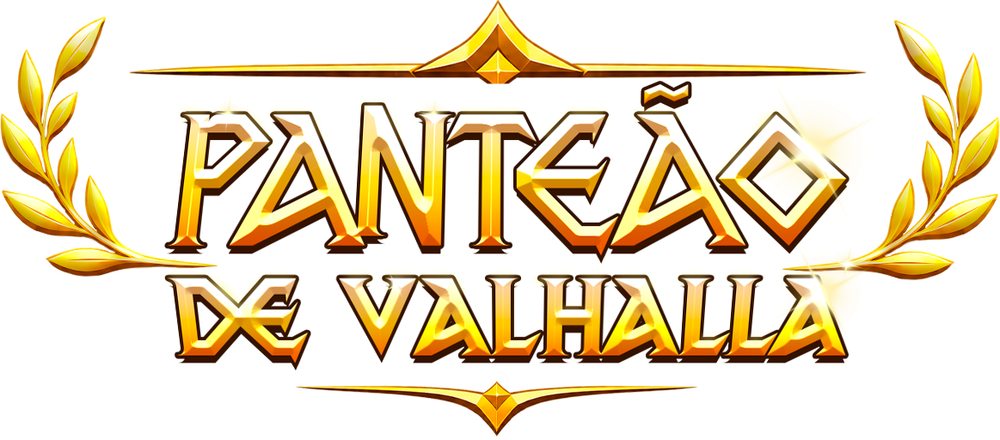
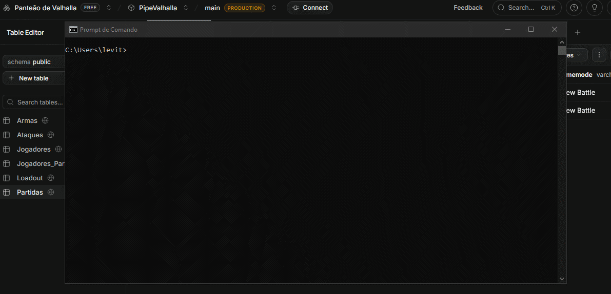

  

    
    
    
  

  

Para quem é de fora do jogo, o **Panteão de Valhalla** é uma organização criada pela comunidade brasileira de *Brawlhalla*. Nela, é administrado um campeonato de pontos corridos com foco em clãs (times) e seus confrontos (um formato de e-Sports diferenciado).

Idealizada originalmente pelo player **YaksaTH** e continuada pela Staff do Panteão, o campeão é o clã com mais pontos adquiridos durante a temporada.

**Acompanhe o Panteão:**
 
    [Canal de Transmissão (Twitch)](https://www.twitch.tv/panteaodevalhalla)
    [Discord Oficial](https://discord.com/invite/QNFGuJHFfg)
    [Site do Panteão](https://coliseurenascimento.great-site.net/index.php)

---

## Sobre o PipeValhalla

O **PipeValhalla** é o sistema de extração de dados do Panteão. Através de comandos via CLI (Interface de Linha de Comando), a ferramenta automatiza a coleta de dados de **qualquer** partida realizada no campeonato, processando as informações e persistindo-as diretamente no Banco de Dados.

### Principal Ferramenta: `-writestats`

Em torneios oficiais de *Brawlhalla*, a coleta de informações das partidas transmitidas praticamente não existia. Para solucionar isso, a equipe de desenvolvedores do jogo disponibilizou uma opção de inicialização via Steam, o `-writestats`.

Com essa opção ativada, o *Brawlhalla* gera automaticamente um arquivo `.json` detalhado com todas as estatísticas da partida (apenas para quem estiver na sala da partida e no modo espectador). Usando o PipeValhalla e com a flag `-writestats` ativada, o Panteão terá um banco de dados alimentado por esse arquivo `.json`, que é também usado em campeonatos oficiais de *Brawlhalla*.
* *Para conferir a estrutura base dos arquivos json, acesse:* `docs/partidas_base/`

---

## Estrutura e Dados

Demonstração do funcionamento do sistema executando o comando de adicionar partida ao banco de dados:

  

Para maior transparência e visualização da modelagem, disponibilizamos os recursos estruturais do projeto:

* **Planilha de Modelo (Google Sheets):** [Acesse o modelo do banco](https://docs.google.com/spreadsheets/d/1MPmtRNx-gMNYI6uvHKEQ9nulzp03lpwjLLW-AeuBe_g/edit?gid=0#gid=0) *(contém 3 partidas de teste inseridas e o esquema das tabelas)*.
* **Dicionário de Dados:** Disponível em `docs/dicionario_de_dados.md`.

---

## Tecnologias Utilizadas

O projeto foi construído utilizando:

* **Linguagem:** Python
* **Banco de Dados:** Supabase / PostgreSQL